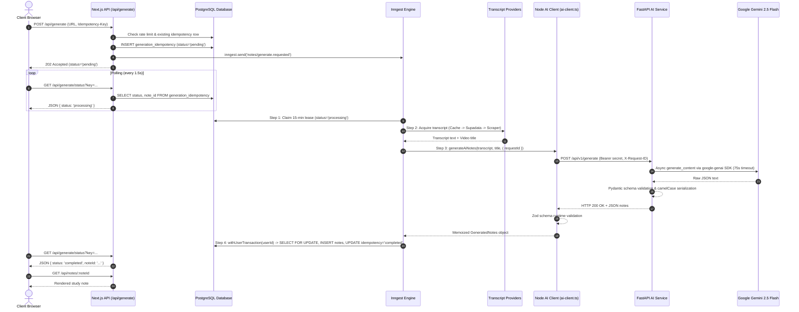

# CodeNotes Architecture

CodeNotes is a multi-tenant, AI-powered study application that transforms YouTube programming tutorials into structured technical study notes. It is built on a resilient, decoupled architecture designed to withstand external API failures, network partitions, and process crashes without losing work or leaking user data.

---

## 1. System Overview

The application cleanly separates fast, synchronous user-facing HTTP interactions, durable background workflow execution, and isolated stateless AI inference:

```mermaid
flowchart TD
    subgraph Client["Client Tier (Browser)"]
        UI["Next.js App Router (React 19)"]
        Polling["TanStack Query (Status Poller)"]
    end

    subgraph API["Application Tier (Next.js 16)"]
        HTTP_Gen["POST /api/generate"]
        HTTP_Status["GET /api/generate/status"]
        HTTP_Notes["GET /api/notes & /api/notes/:id"]
        HTTP_Metrics["GET /api/metrics"]
        HTTP_Health["GET /api/health"]
        AuthMid["Proxy Middleware (Supabase Auth)"]
    end

    subgraph Execution["Durable Execution Tier (Inngest)"]
        InngestHandler["/api/inngest Endpoint"]
        FnGen["Durable Function: generate-notes"]
        FnRecon["Cron Function: reconcile-stale-generations"]
    end

    subgraph External["External Transcripts & Upstream APIs"]
        Supadata["Supadata API (Primary Transcript)"]
        YT["YouTube Scraper (Fallback Transcript)"]
    end

    subgraph Microservice["AI Inference Tier (FastAPI Microservice)"]
        FastAPIService["FastAPI Service (/api/v1/generate)"]
        GeminiSDK["google-genai SDK"]
        GeminiUpstream["Google Gemini 2.5 Flash"]
    end

    subgraph Data["Persistence Tier (PostgreSQL)"]
        T_Notes["notes (RLS Enforced)"]
        T_Idemp["generation_idempotency"]
        T_Trans["youtube_transcripts (Shared Cache)"]
        T_Rate["rate_limit_buckets"]
    end

    subgraph Monitoring["Observability Stack"]
        Prom["Prometheus (Scraper)"]
        Graf["Grafana Dashboard"]
        SentryService["Sentry (Sanitized Errors)"]
    end

    UI -->|1. Submit YouTube URL| HTTP_Gen
    UI -->|2. Poll job status| HTTP_Status
    UI -->|Read library| HTTP_Notes
    HTTP_Gen -->|Authenticate & Check Limit| AuthMid
    HTTP_Gen -->|Insert 'pending' record| T_Idemp
    HTTP_Gen -->|Dispatch event| InngestHandler

    InngestHandler --> FnGen
    InngestHandler --> FnRecon

    FnGen -->|Claim 15m lease| T_Idemp
    FnGen -->|1. Check cache / fetch| T_Trans
    FnGen -->|2. Primary fetch| Supadata
    FnGen -->|3. Fallback fetch| YT
    FnGen -->|4. Invoke FastAPI Service| FastAPIService
    FastAPIService -->|google-genai client| GeminiSDK
    GeminiSDK -->|API request| GeminiUpstream
    GeminiUpstream -->>|Inference JSON| GeminiSDK
    GeminiSDK -->>|Pydantic validation| FastAPIService
    FastAPIService -->>|Validated CamelCase JSON| FnGen
    FnGen -->|5. Atomic RLS transaction| T_Notes
    FnGen -->|5. Mark 'completed'| T_Idemp
    FnGen -.->|Unrecoverable error| SentryService

    FnRecon -->|Scan stale jobs & re-dispatch| T_Idemp
    FnRecon -->|Re-dispatch event| InngestHandler

    Prom -->|Scrape metrics| HTTP_Metrics
    Graf -->|Query PromQL| Prom
```

---

## 2. Synchronous Ingestion vs. Asynchronous Durable Execution

### A. Synchronous Ingestion (`POST /api/generate`)
1. **Authentication**: Resolves user session via Supabase Auth ([`src/lib/auth.ts`](../src/lib/auth.ts)).
2. **Rate Limiting**: Checks PostgreSQL token bucket ([`src/lib/rate-limit.ts`](../src/lib/rate-limit.ts)) to enforce per-user request limits.
3. **Payload Validation**: Canonicalizes YouTube URL and extracts video ID ([`src/lib/transcript.ts`](../src/lib/transcript.ts)).
4. **Idempotency Check**: Determines the idempotency key:
   - If the `Idempotency-Key` request header is present, its trimmed string value is used.
   - If the header is omitted, the key is deterministically derived as `sha256("${userId}:${videoId}")`.
   - In the web UI ([`src/components/UrlInput.tsx`](../src/components/UrlInput.tsx)), each submission generates a fresh UUID in the `Idempotency-Key` header.
   - Looks up `generation_idempotency` by `(user_id, key)`:
     - If already `completed`: Returns `200 OK` with cached `noteId` immediately (no AI work re-executed). Replay of a UI-created job requires reusing that exact `Idempotency-Key` UUID. A request without the header uses a different, deterministic key unless the original request also omitted the header.
     - If `processing` or `pending`: Replays current status with `202 Accepted`.
     - If payload mismatch (reusing key with different video ID): Rejects with `422 Unprocessable Entity`.
     - Submitting the same video with a separate UUID creates a distinct generation record: it benefits from transcript caching via `youtube_transcripts` (avoiding external caption calls), but executes AI inference again to create an independent note rather than deduplicating notes.
5. **Durable Reservation**: Atomically inserts or updates row with status `pending`.
6. **Event Dispatch**: Dispatches `notes/generate.requested` with deterministic event ID `gen-${userId}-${idempotencyKey}` to Inngest.
7. **Immediate Response**: Returns `202 Accepted` within ~50ms. The browser client switches to non-blocking polling.

### B. Asynchronous Durable Generation (`generate-notes`)
Background execution runs inside Inngest ([`src/inngest/functions/generate-notes.ts`](../src/inngest/functions/generate-notes.ts)), divided into durable steps:



---

## 3. Step-by-Step Generation Lifecycle

| Step | Scope | Description | Error Handling |
| :--- | :--- | :--- | :--- |
| **1. `claim-generation-processing`** | DB Query | Verifies job isn't already finished or actively claimed by another worker; claims a 15-minute lease (`lease_until = NOW() + INTERVAL '15 minutes'`). | Skips execution if active lease held; fails fast on payload mismatch. |
| **2. `fetch-transcript-and-title`** | External I/O (Outside DB Tx) | Checks `youtube_transcripts` table for shared cached transcript. If miss, calls Supadata API with timeout (15s). If Supadata fails, falls back to `youtube-transcript`. Extracts title via YouTube oEmbed (4s timeout). | Raises non-retriable `TRANSCRIPT_UNAVAILABLE` if video has no captions; retries transient network timeouts. |
| **3. `generate-ai-notes`** | HTTP / Microservice I/O (Outside DB Tx) | Invokes [`generateAiNotes()`](../src/lib/ai-client.ts) pointing to the standalone FastAPI microservice (`POST /api/v1/generate`) with `Authorization: Bearer <FASTAPI_SERVICE_SECRET>` and `X-Request-ID`. FastAPI runs Gemini 2.5 Flash inference. Return payload is validated by Pydantic on FastAPI and Zod on Node.js. | Retries transient 429, 500, 502, 503, 504, and network timeout errors (up to 2 retries). Throws `NonRetriableError` immediately on 401, 403, 422, or malformed schema. |
| **4. `persist-notes`** | DB Transaction (`withUserTransaction`) | Checks out a database client, acquires `SELECT ... FOR UPDATE` row lock on `generation_idempotency`, sets transaction-local user claim, inserts note into `notes`, updates idempotency row to `completed`, and marks lease released. Takes < 20ms. | Database connection retries handled by Inngest durable step wrapper. Transaction ensures zero duplicate notes are inserted even across replayed steps. |
| **`onFailure` Hook** | Terminal Failure Handler | Invoked when all retries are exhausted or an unrecoverable `NonRetriableError` occurs. Updates `generation_idempotency` to `failed` with classified error code, logs structured failure, and reports sanitized error to Sentry. | Self-contained, best-effort execution with Sentry flush timeout (1.5s). |

---

## 4. Multi-Tenant Isolation & PostgreSQL Row Level Security (RLS)

All personal data (saved notes and search queries) is strictly protected by PostgreSQL Row Level Security policies at the database layer.

### The `withUserTransaction` Pattern
Application queries touching user-scoped data do not execute as an unrestricted superuser. Instead, they execute through [`src/lib/db.ts`](../src/lib/db.ts):

```sql
BEGIN;
SET LOCAL "request.jwt.claim.sub" = '<userId>';
SET LOCAL ROLE authenticated;
-- User query runs here:
INSERT INTO notes (user_id, title, ...) VALUES (...);
COMMIT;
```

### Enforced Database Policies
```sql
ALTER TABLE notes ENABLE ROW LEVEL SECURITY;
ALTER TABLE notes FORCE ROW LEVEL SECURITY;

CREATE POLICY "Users can only read own notes" ON notes
  FOR SELECT TO authenticated
  USING (user_id = auth.uid());

CREATE POLICY "Users can only insert own notes" ON notes
  FOR INSERT TO authenticated
  WITH CHECK (user_id = auth.uid());

CREATE POLICY "Users can only update own notes" ON notes
  FOR UPDATE TO authenticated
  USING (user_id = auth.uid())
  WITH CHECK (user_id = auth.uid());

CREATE POLICY "Users can only delete own notes" ON notes
  FOR DELETE TO authenticated
  USING (user_id = auth.uid());
```

Because `FORCE ROW LEVEL SECURITY` is enabled, table owners and application database users cannot bypass RLS policies even if application filtering code omits `WHERE user_id = ...`.

---

## 5. Distributed Idempotency & Crash-Safe Reconciliation

Network hiccups between the web server and Inngest or external APIs can occur in real-world environments. CodeNotes guards against data inconsistency using a three-tier safety net:

1. **Deterministic Inngest Event IDs**:
   Events are dispatched with `id: gen-${userId}-${idempotencyKey}`. If the application server retries `inngest.send()`, Inngest deduplicates the event at ingestion.
2. **15-Minute Processing Leases**:
   The `generation_idempotency` record holds a `lease_until` timestamp. If a worker terminates abruptly midway through generation, the lease expires after 15 minutes, allowing a subsequent attempt or reconciliation to reclaim the job safely.
3. **Automated Cron Reconciliation (`reconcile-stale-generations`)**:
   An Inngest cron job runs every 5 minutes ([`src/inngest/functions/reconcile-stale.ts`](../src/inngest/functions/reconcile-stale.ts)):
   - **Case A**: Finds jobs stuck in `pending` for > 60 seconds (e.g., initial `inngest.send` dropped or worker failed to pick up) and re-dispatches the Inngest event with metrics tracking.
   - **Case B**: Finds jobs stuck in `processing` with expired leases (`lease_until < NOW()`) and re-dispatches them with deterministic event IDs.

---

## 6. Shared Transcript Caching

Transcripts are public YouTube metadata. When User A generates notes for a video, the raw transcript is persisted to the public `youtube_transcripts` table ([`src/lib/transcript.ts`](../src/lib/transcript.ts)). When User B subsequently submits the same video:
- The system reuses the cached transcript, saving upstream API quota and reducing latency by ~3–5 seconds.
- User B's generated notes are still independently created and isolated in `notes` under User B's RLS policy.

---

## 7. AI Generation Microservice Boundary & Reliability Guarantees

The integration between CodeNotes and the standalone FastAPI AI Generator microservice introduces a formal distributed service boundary.

### A. Component Responsibilities

- **Next.js & Inngest**:
  - Owns user authentication, input rate-limiting, and workflow state transitions.
  - Owns all database persistence and multi-tenant RLS boundaries in PostgreSQL.
  - Dispatches Step 3 to the microservice using [`src/lib/ai-client.ts`](../src/lib/ai-client.ts).
  - Enforces client-side timeout: `85 seconds` (`DEFAULT_AI_TIMEOUT_MS`).
  - Enforces runtime Zod validation on received response bodies.
- **FastAPI Microservice** ([`services/ai-generator`](../services/ai-generator)):
  - **Stateless Compute**: Owns prompt formulation, Google Gemini SDK execution, and Pydantic schema validation.
  - Possesses **no database connection**, no Redis cache, and no persistent store.
  - Enforces Bearer token verification via `FASTAPI_SERVICE_SECRET`.
  - Normalizes and logs `X-Request-ID` across all operational telemetry.
  - Enforces outbound Gemini timeout: `75 seconds` (`GEMINI_TIMEOUT_MS`).
  - Serializes response strictly as camelCase JSON conforming to `GeneratedNotes`.

### B. Error Taxonomy & Inngest Retry Classification

Errors raised during Step 3 pass through [`classifyError()`](../src/inngest/functions/generate-notes.ts):

| Error Type / Cause | HTTP Status | Retry Action | Rationale |
| :--- | :---: | :--- | :--- |
| **`CONFIG_ERROR`** (Missing secret, bad URL, invalid auth) | 401, 403, 503 | Immediate Failure (`NonRetriableError`) | Configuration and credential mismatches will not resolve on retry. |
| **`INVALID_REQUEST`** (Transcript empty, title > 500 chars) | 422 | Immediate Failure (`NonRetriableError`) | Schema/validation rejections are deterministic. |
| **`MALFORMED_AI_OUTPUT`** (Zod/Pydantic validation failure) | 502 | Immediate Failure (`NonRetriableError`) | Malformed output indicates model non-compliance; fails fast. |
| **`RATE_LIMITED`** (Gemini 429 quota exhaustion) | 429 | **Retryable** (Up to 2 retries) | Upstream quotas recover under exponential backoff. |
| **`TIMEOUT`** (FastAPI 504 or Node 85s abort) | 504 / Abort | **Retryable** (Up to 2 retries) | Transient network or upstream model latency spikes. |
| **`UPSTREAM_ERROR`** (Gemini 500 / 502 / 503 Overloaded) | 500, 502, 503 | **Retryable** (Up to 2 retries) | Temporary Google infrastructure failure. |
| **`NETWORK_ERROR`** (DNS failure, connection reset, cold start) | Socket Drop | **Retryable** (Up to 2 retries) | Transient connectivity drop or Vercel container spin-up. |

### C. Retry Policies & Timeout Hierarchy

- **Inngest Function Retry Limit**: `retries: 2` (3 total execution attempts).
- **Execution Envelope Hierarchy**:
  $$\text{Gemini Timeout (75s)} < \text{Node AI Client Abort (85s)} < \text{Vercel maxDuration (90s)} \ll \text{Inngest Finish (10m)}$$
  This strict ordering guarantees that:
  1. Gemini will abort and return a structured HTTP 504 before Node.js cuts the socket.
  2. Node.js client abort timer will fire before Vercel serverless edge proxy cuts the connection.
  3. Inngest function timeout (`10 minutes`) provides ample budget for up to 3 retry attempts with exponential backoff and jitter.

### D. Step Memoization & Idempotency Guarantees

1. **Database Idempotency Guarantee (Zero Duplicate Notes)**:
   - In Step 4, persistence executes inside `withUserTransaction` with a `SELECT ... FOR UPDATE` lock on `generation_idempotency`.
   - If a step is re-run after note creation, the transaction identifies `status = 'completed'` and exits immediately as a safe no-op.
   - **Guaranteed by database constraints and row locking**: Exactly one note row can ever be committed per idempotency key.
2. **Inngest Step Memoization**:
   - Inngest memoizes the output of completed steps. If Step 4 crashes due to a temporary database pool exhaustion, Inngest retries Step 4 using the memoized Step 3 return value. It does **not** call FastAPI or Gemini again.

### E. Documented Limitations & The Ambiguous-Success Edge Case

- **Request IDs Do Not Deduplicate Inference**:
  - The `X-Request-ID` header is propagated from the entrypoint through Inngest to FastAPI for structured logging and distributed tracing.
  - Because FastAPI is stateless and possesses no cache or database, **FastAPI does not deduplicate requests**. Every valid HTTP request reaching FastAPI initiates an inference call to Gemini.
- **The Ambiguous-Success Case (Repeated Gemini Inference Cost)**:
  - If Gemini completes inference successfully, but the network connection drops or times out before Inngest durably commits the memoized Step 3 output, Inngest marks Step 3 as incomplete and retries it.
  - On retry, Inngest invokes Step 3 again, dispatching another HTTP request to FastAPI and calling Gemini a second time.
  - **Impact**: In this scenario, an additional Gemini inference call is executed and billed. However, database integrity is never compromised: Step 4's row lock guarantees that only one note is ever committed.

For production deployment instructions, troubleshooting runbooks, and rollback procedures, see the [FastAPI Production Runbook](fastapi-production-runbook.md).
